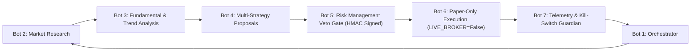

# `quant-portfolio-analyzer`

[](https://github.com/kaledbouchagraoui7-bot/quant-portfolio-analyzer/actions/workflows/ci.yml)

> **Informational Quantitative & Mathematical Analytics Only:** Outputs are deterministic educational/research math calculations on public or user-supplied CSV/JSON series — not certified financial advice, investment recommendations, or live brokerage execution.

Deterministic Python CLI and zero-install browser calculator (`demo.html` / [GitHub Pages](https://kaledbouchagraoui7-bot.github.io/quant-portfolio-analyzer/)) for portfolio risk, tail loss, compounding, and risk-parity allocation analytics, adapted cleanly from open-source Track A patterns (`shashankvemuri/Finance` [MIT], `skfolio/skfolio` [BSD-3-Clause]).

## Capabilities
- **Performance & Ratios:** Total Return, CAGR, Annualized Volatility, Sharpe Ratio, Sortino Ratio, Maximum Drawdown (peak/trough), Calmar Ratio, and capped Fractional Kelly Sizing (25% hard cap).
- **Tail Risk:** Historical & Parametric Value-at-Risk (`VaR_95`, `VaR_99`) plus Historical Expected Shortfall (`CVaR_95`).
- **Compounding Simulator:** Lump-Sum vs. spaced Dollar-Cost Averaging (DCA) portfolio comparison.
- **Multi-Asset Allocation:** Inverse-Volatility / Risk-Parity basket weighting across multiple CSV/JSON price columns.
- **7-Bot Risk-Governed Research Architecture (`src/multi_bot_engine/`):** Strict separation of duties across `orchestrator_bot`, `market_research_bot`, `analysis_bot`, `strategy_bot`, `risk_management_bot` (HMAC-signed veto gatekeeper), `execution_bot` (`LIVE_BROKER_ENABLED = False`, paper-only), and `monitoring_bot` (`6%` throttle / `12%` kill switch).



> **Open-Source Quantitative Research & Risk-Analytics Software — Not Investment Advice (AMF / MiFID II Compliant).** `AGE_18_MONETIZATION_GATE = True` · `PAPER_TRADING_ONLY = True` · `MAX_LEVERAGE = 1.0`.

## Quick Start
```bash
python quant_portfolio_analyzer.py --input sample_prices.csv --periods-per-year 12 --format md
pytest -v
```

<!-- VAULT_GRAPH_WEAVER_START -->
## Related Vault Nodes
- **Cluster:** *Software Ventures & Python Suites*
- **Connected Hubs:** [[Home]] | [[ID_CARD]] | [[MOC_Projects]] | [[GitHub_Alpha_Radar]]
<!-- VAULT_GRAPH_WEAVER_END -->
